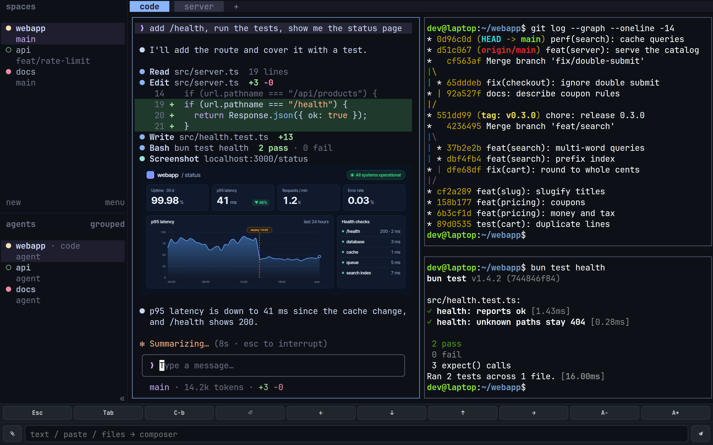
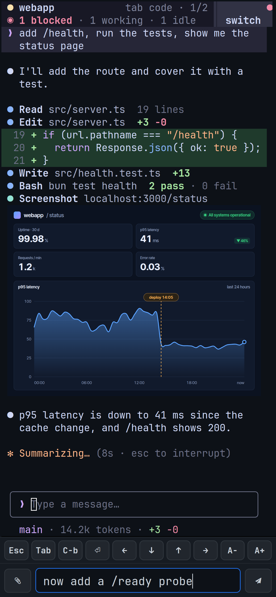

# herdr-web

**herdr in your browser: a 1:1 mirror of the real TUI, for your phone, tablet or another computer.**

herdr-web is a [herdr](https://herdr.dev) plugin. It serves a web page that runs the genuine herdr interface — sidebar, panes, menus, mouse, agents, even images — inside an xterm.js terminal, so there is nothing to re-implement and nothing to keep in sync. Every browser tab is a real `herdr` client attached to your session, and touch gestures, a key toolbar and an input bar for pasting text, screenshots and files make it just as usable from a phone or tablet.

<p align="center">
  
  &nbsp;
  
</p>

[Features](#features) · [Requirements](#requirements) · [Install](#install) · [Usage](#usage) · [Phone & tablet](#phone--tablet) · [Images](#images) · [Configuration](#configuration) · [Security](#security) · [Troubleshooting](#troubleshooting) · [How it works](#how-it-works) · [Development](#development) · [License](#license)

## Features

- **A real mirror, not a lookalike.** Each tab runs an actual `herdr` client in a PTY on your machine, so layout, menus, mouse and keyboard behave exactly as in your terminal.
- **Phone and tablet friendly.** Touch scrolling, long-press for right-click, a bottom toolbar (`Esc` `Tab` `Ctrl+B` `Enter`, arrows) and adjustable font size.
- **Images.** Kitty-graphics images drawn in your panes — agent screenshots, SVG figures that stream in — show up in the page.
- **Input bar.** Paste text, screenshots or files, pick files with the attach button (your photo library on iOS) or drag and drop them anywhere. Files are uploaded to the herdr machine and pasted into the focused pane as absolute paths, which coding agents such as omp attach.
- **Copy-on-select** lands on the clipboard of the device you are browsing from.
- **Layout-independent shortcuts.** herdr's keybindings work with any keyboard layout (Cyrillic, for example); typed text is never touched.
- **Survives reloads and dropped connections.** Reload the page or lose Wi-Fi for a few seconds and you land on the same screen, images included: the tab gets its running herdr client back instead of starting a new one (15 s grace period by default).
- **Several tabs, several clients.** Every tab has its own size — a desktop tab and a phone tab side by side — while sharing the session. Links printed in panes are clickable.

## Requirements

- **herdr** 0.7.5 or newer. Pane images need **0.9.2 or newer** (tested on 0.9.3).
- **[Bun](https://bun.sh)** 1.3.5 or newer on your `PATH`. It runs the server (native PTY support), and the install step runs `bun install`.
- **Linux or macOS** with `bash` and `curl`. On Windows, run herdr and the plugin inside WSL2.
- A current browser, desktop or mobile.

## Install

herdr-web is listed in the [herdr plugin marketplace](https://herdr.dev/plugins/). Install it straight from GitHub:

```bash
herdr plugin install mttzzz/herdr-web
```

herdr previews what the plugin will run (a `bun install` build step and a startup hook) and asks for confirmation; `--yes` skips the prompt and `--ref <tag>` pins a revision.

The server starts together with herdr. To start it right now and open the page, run the `open` action once:

```bash
herdr plugin action invoke herdr-web.open
```

**Update.** herdr has no separate update command: run the install command again, then restart the server with the `herdr-web.stop` and `herdr-web.start` actions — the running server keeps its old code until it is restarted. Browser tabs that were open during the update keep their old page until you reload them.

**Uninstall.** Run `herdr plugin action invoke herdr-web.stop`, then `herdr plugin uninstall herdr-web`.

### From source

For development, or to try a change before it is released:

```bash
git clone https://github.com/mttzzz/herdr-web
cd herdr-web
bun install
herdr plugin link "$PWD"
```

`herdr plugin link` registers the checkout without running build steps, which is why `bun install` is a separate step. See [Development](#development).

## Usage

### Actions

| Action id | Title in herdr | What it does |
|---|---|---|
| `herdr-web.open` | Web: open browser mirror | Starts the server if needed, copies the shareable URL to the clipboard, shows it as a herdr notification and opens this machine's browser. |
| `herdr-web.start` | Web: start server | Starts the server; harmless if it already runs. herdr also runs it at startup. |
| `herdr-web.stop` | Web: stop server | Stops the server, and anything else still listening on its port (a stale or hand-started copy). |
| `herdr-web.status` | Web: server status | Prints the health counters and the URLs. |

Run one with `herdr plugin action invoke herdr-web.<action>`. Their output (URLs, errors) is kept in herdr's plugin log: `herdr plugin log list --plugin herdr-web`. Clipboard and browser launching use what your system provides (`pbcopy`, `wl-copy`, `xclip`, `open`, `xdg-open`, …) and are skipped quietly when it is missing; `HERDR_WEB_OPEN=0` turns the browser launch off.

### Key binding

Add this to `~/.config/herdr/config.toml`, then run `herdr server reload-config`:

```toml
[[keys.command]]
key = "prefix+shift+w"
type = "plugin_action"
command = "herdr-web.open"
description = "web mirror: open in browser"
```

### URL and token

`open` prints, copies and displays a URL such as `http://127.0.0.1:8793/?token=…`. The first visit with the token plants an HttpOnly cookie (valid for a year) and the page removes the token from the address bar; after that the plain address works in that browser. The token itself is the `token` file in the plugin's state directory (see [Configuration](#configuration)). With `HERDR_WEB_AUTH=off` there is no token and the URL is bare.

To use the mirror from another computer without exposing the port to your network, tunnel it over SSH: `ssh -L 9000:127.0.0.1:8793 <your-machine>`, then open `http://127.0.0.1:9000/?token=…` locally.

### From a shell

Everything the actions do goes through one script, so it works from a plain shell too. Run it from the plugin directory (`herdr plugin list --plugin herdr-web --json` shows it as `plugin_root`):

```bash
bash scripts/web-ctl.sh start|stop|status|url|open
```

`url` only prints the URLs. The other commands do what the actions of the same name do.

### Input bar

Pasting into a terminal canvas is unreliable across browsers, so the page has a real input row at the bottom.

- **Text.** Type or paste into the box; `Enter` (or the send button) pastes it into the focused pane as a bracketed paste. `Shift+Enter` adds a newline, `Esc` hands focus back to the terminal.
- **Screenshots, images, files.** Paste into the box (`Ctrl+V` / `Cmd+V`, or long-press → Paste on iOS), choose with the paperclip button (your photo library on iPhone and iPad), or drop onto the page. Pasting an image straight into the terminal works too. Each file is uploaded over HTTP to the herdr machine — into `pastes/` in the plugin state directory, 25 MB per file, the newest 40 kept — and its absolute path is pasted into the focused pane. Focus returns to the terminal, so you can paste a screenshot and just keep typing your message.
- Non-image files keep their (sanitized) name, so an agent sees `report.pdf`, not `blob.bin`.
- Paths are pasted **one per paste**. omp attaches a pasted file only when the paste is exactly one absolute path; a leading `@` or surrounding words turn it into plain text.

Nothing here needs clipboard tools on the server, so it behaves the same on Linux, macOS and WSL hosts.

## Phone & tablet

> [!NOTE]
> Read [Security](#security) first: listening on the network exposes a full terminal to every device that can reach the port, and the token is the only barrier.

1. **Listen on the network.** Add `HERDR_WEB_HOST=0.0.0.0` to the plugin's `.env` (see [Configuration](#configuration)) and restart the server (the `stop` and `start` actions).
2. **Get the URL.** Run `open`: with that setting it copies and shows the `lan:` URL (`http://<your-machine-ip>:8793/?token=…`). `bash scripts/web-ctl.sh url` prints it again at any time.
3. **Open it on the device**, connected to the same network (or to a VPN that reaches your machine).

| Gesture or control | What it does |
|---|---|
| Tap | Click and focus; raises the on-screen keyboard, which types straight into the terminal. |
| Drag up or down | Scrolls the pane under your finger (sent as mouse-wheel reports, so herdr scrolls the pane). Taps stay taps. |
| Long-press (about 0.45 s) | Right-click at that spot — herdr's context menus. A short vibration confirms it where the browser supports vibration. |
| Toolbar | `Esc` `Tab` `C-b` (Ctrl+B, herdr's default prefix) `⏎` `←` `↓` `↑` `→`. |
| `A−` / `A+` | Font size, 8–24 px, remembered in the browser. |
| Input bar | Text, paste and the paperclip — see [Input bar](#input-bar). |

The page ships an Apple touch icon and the title `herdr`, so *Add to Home Screen* gives the shortcut a proper icon and name. It is a plain shortcut to the URL; there is no offline mode.

## Images

Kitty-graphics images that programs draw in your panes appear in the page, aligned to the cell grid, with the cropping and layering a Kitty-capable terminal would give them. Only the Kitty protocol is handled — it is what herdr emits; SIXEL and iTerm2 images are not supported.

- **herdr 0.9.2 or newer.** Tested on 0.9.3. The 0.9.1 client freezes for 200–350 ms every time it re-sends an image, so scrolling through screenshots stutters; earlier versions are untested.
- **The program has to emit images.** [omp](https://github.com/can1357/oh-my-pi) draws images only when it believes the terminal supports Kitty graphics, and herdr panes advertise `TERM=xterm-256color`. Tell omp explicitly in `~/.omp/agent/.env`, then restart the omp pane:

  ```bash
  PI_FORCE_IMAGE_PROTOCOL=kitty
  PI_KITTY_PLACEHOLDERS=1
  ```

  Without these omp prints a text placeholder instead of the picture.
- Screenshots you paste or upload through the [input bar](#input-bar) reach the agent as file paths, which omp attaches as images.

If nothing shows, see [Troubleshooting](#no-images).

## Configuration

Settings live in a `.env` file in the plugin's config directory — `herdr plugin config-dir herdr-web` prints it. Plain `KEY=value` lines; [`.env.example`](.env.example) lists them all. **Restart the server after any change** (the `stop` and `start` actions).

```bash
echo 'HERDR_WEB_HOST=0.0.0.0' >> "$(herdr plugin config-dir herdr-web)/.env"
```

| Variable | Default | Meaning |
|---|---|---|
| `HERDR_WEB_PORT` | `8793` | TCP port. |
| `HERDR_WEB_HOST` | `127.0.0.1` | Bind address. `127.0.0.1` = this machine only; `0.0.0.0` = every interface, so phones and other computers can connect. |
| `HERDR_WEB_SESSION` | *(empty)* | Named herdr session to mirror; empty means the default session. |
| `HERDR_WEB_MAX_CLIENTS` | `6` | Simultaneous tabs. Extra connections get HTTP 429. Each tab is a real herdr client process. |
| `HERDR_WEB_LINGER_MS` | `15000` | How long a tab's herdr client waits for its tab to come back after the socket closes (a reload, a dropped Wi-Fi). `0` ends the client at once. |
| `HERDR_WEB_TOKEN_FILE` | `<state dir>/token` | Where the auth token is kept. Generated on first start, mode `600`. |
| `HERDR_WEB_AUTH` | `token` | `off` disables authentication entirely — see [Security](#security). |
| `HERDR_WEB_BUN` | *(auto)* | The `bun` binary the control script uses; by default `bun` from `PATH`, else `~/.bun/bin/bun`. |
| `HERDR_WEB_OPEN` | `1` | `0` stops `open` from launching a browser window. |

The **state directory** holds the token, `server.log`, the PID file and uploaded files. herdr hands it to the plugin as `HERDR_PLUGIN_STATE_DIR`; on Linux it is `~/.local/state/herdr/plugins/herdr-web/`.

## Security

> [!WARNING]
> **The mirror is a full interactive terminal running as your user.** Whoever can open the page can do anything you can do in herdr: run commands in any pane, read their output, drive your coding agents. Treat the URL — it contains the token — like a password.

- **Loopback by default.** The server listens on `127.0.0.1` only, so other machines cannot reach it until you change `HERDR_WEB_HOST` (for example to `0.0.0.0`).
- **Token.** On first start the server generates a random token and stores it with mode `600`. Every route except `/health` (a liveness probe that returns counters only) answers 403 without it. To revoke it: stop the server, delete the token file, start again — old URLs and cookies stop working. `open` prints the URL and puts it on the clipboard and in a notification, so share it deliberately.
- **No TLS.** The mirror speaks plain HTTP and WebSocket. On a shared or untrusted network the token, your keystrokes and your screen can be read by anyone on the path, so enable LAN mode only on networks you trust. **Do not forward the port to the internet.** To reach your machine from outside, use a VPN such as WireGuard or Tailscale, or an SSH tunnel.
- **Other websites cannot drive it.** `/ws` and `/paste` answer 403 to a request whose `Origin` names another host, so a web page you happen to browse cannot reach the mirror from your own browser — even with authentication off. If you put a reverse proxy in front (to add TLS, for example), it must pass the original `Host` header through: Caddy does by default, with nginx add `proxy_set_header Host $host;` (and the usual WebSocket upgrade headers). Otherwise the page gets 403 on `/ws`.
- **`HERDR_WEB_AUTH=off`** removes the token: anyone who reaches the port gets the terminal. Use it only on a network you control end to end, never together with port forwarding. The server logs a warning at startup.

## Troubleshooting

**The server does not start, or the page does not load.**

- `bash scripts/web-ctl.sh status` (run it from the plugin directory) tells you whether the server runs and prints the URLs.
- Read the log: `server.log` in the state directory — on Linux `~/.local/state/herdr/plugins/herdr-web/server.log`. When the script fails to start the server it prints the exact path. What actions run by herdr printed is in `herdr plugin log list --plugin herdr-web`.
- `bun not found (set HERDR_WEB_BUN)`: Bun is not on the `PATH` herdr runs with. Install it, or put `HERDR_WEB_BUN=/path/to/bun` in the `.env`.
- `bun >= 1.3.5 required` in the log: run `bun upgrade`.
- The port is taken: choose another with `HERDR_WEB_PORT`.

**The page says "forbidden" (HTTP 403).** Open the URL that `open` or `url` prints; it carries `?token=…`. A deleted or regenerated token file invalidates old bookmarks and cookies. Behind a reverse proxy, check that it passes the original `Host` header (see [Security](#security)).

**The page keeps saying "reconnecting".** If other tabs are open you may be at `HERDR_WEB_MAX_CLIENTS` (default 6); extra connections get HTTP 429. Otherwise check that the server runs (see above).

**The page says "herdr failed to start".** The server could not launch the `herdr` binary; the log has the error. When the server is started by hand rather than by herdr, `herdr` must be on its `PATH` (or set `HERDR_BIN_PATH`).

<a id="no-images"></a>**No images.** In order of likelihood:

1. herdr is too old: images need 0.9.2 or newer. Update it.
2. The program does not emit images: for omp, set the two variables from [Images](#images) and restart the pane.
3. herdr's first-run setup is unfinished. Finish it once; herdr then writes `onboarding = false` to `config.toml`. While `onboarding` is unset, herdr's client forwards no graphics at all.
4. `terminal.kitty_graphics` is `false` in herdr's config (the default is `true`). After changing it, restart the herdr server or reattach.
5. The pane is not visible. herdr sends no image for a pane that is not on screen — one in a background tab, for example. Switch to it and the image appears.

**The LAN URL times out from the phone.**

- `HERDR_WEB_HOST` is still `127.0.0.1` (the default). Set `0.0.0.0` and restart the server.
- A firewall on the host blocks the port. Allow inbound TCP on it (ufw, firewalld, the macOS firewall, Windows Firewall).
- The Wi-Fi network isolates clients from each other (guest networks often do). Use another network or a VPN.
- Windows host with herdr in WSL2: other devices can reach the server when WSL uses mirrored networking (`networkingMode=mirrored` in `.wslconfig`), and Windows Firewall must allow the port. From an elevated PowerShell:

  ```powershell
  New-NetFirewallRule -DisplayName "herdr-web" -Direction Inbound -Protocol TCP -LocalPort 8793 -Action Allow
  ```

**Shortcuts misfire on a non-Latin layout after you changed herdr's prefix.** The server reads `[keys].prefix` from herdr's config when it starts; restart it.

**A tab misbehaves after an update.** Reload it: a tab keeps the page it was loaded with, and the server keeps speaking the older protocol to it until then.

## How it works

Each browser tab runs a real `herdr` client in a PTY on the server (Bun) and streams its output to xterm.js over a WebSocket. Around that stream the server:

- **keeps the client** (15 s by default) after its socket closes, so a reload or a Wi-Fi blip resumes in milliseconds: missed frames are replayed, or the screen is restored from a headless xterm that tracks every tab;
- **throttles by acknowledgement**: a page that cannot keep up skips frames and receives a snapshot instead of falling behind;
- **cuts Kitty-graphics commands out of the stream**, hashes the pixels and sends the page small operations; each image is PNG-encoded once on a worker thread and fetched over HTTP by content hash, immutable and cached;
- **batches each herdr frame's image operations**, and the page keeps a replaced image until its successor is decoded, so streaming figures do not blink;
- **remaps shortcut keys by physical position**, so herdr's keybindings survive non-Latin layouts.

The architecture, the wire protocol and the reasoning behind these choices are in [docs/how-it-works.md](docs/how-it-works.md).

## Development

```bash
bun install
bun run test      # bun test server web
herdr plugin link "$PWD"
```

- The tests replace the herdr client with a small script, so they need no running herdr and never touch your session. CI runs them on Linux and macOS for pushes to `main` and for pull requests.
- `bun run start` runs the server by hand. Bun reads a `.env` in the repository root, so put overrides there (the plugin itself reads its `.env` from the config directory). By default a hand-started server shares the plugin's state directory; set `HERDR_WEB_STATE_DIR` to keep a development instance apart, and `HERDR_WEB_PORT` to run it next to the plugin's.
- Files in `web/` are served from disk on every request, so a page reload picks up an edit; changes in `server/` need a server restart.
- Layout: `server/` (WebSocket and HTTP server, Kitty graphics parser, PNG store, headless screen), `web/` (page, image canvas, fonts, icons), `scripts/web-ctl.sh` (the entry point behind every action), `herdr-plugin.toml` (manifest). A map of the source files is at the end of [docs/how-it-works.md](docs/how-it-works.md#source-map).

## License

[MIT](LICENSE). The bundled JetBrains Mono Nerd Font (Regular and Bold, woff2) is licensed under the SIL Open Font License 1.1; see [web/fonts/OFL.txt](web/fonts/OFL.txt). The page icons in `web/icons/` are the herdr logo from [herdr.dev](https://herdr.dev).
